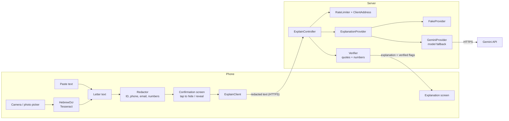

# PlainLetter – "מה רוצים ממני?"

An Android app that explains official Hebrew letters in simple words: a tax demand, a parking fine,
a court summons, a bank notice. Take a photo of the letter (or paste its text), and get a short
summary and the points that matter: what you need to do, by when, and how much it costs.

Built for people who find official letters hard to read, with privacy first: **the photo never leaves
the phone, and personal details are hidden on the phone before anything is sent.**

**Server:** https://plainletter.onrender.com/health
*(Free hosting: the first request after a period of inactivity can take up to a minute while the server wakes up.)*

---

## How it works

1. **Photo or text** – take a photo with the camera, pick an existing image, or paste the text.
2. **Reading the photo on the phone** – Hebrew text recognition (Tesseract) runs on the device.
   The camera photo is kept in a private temporary file and deleted as soon as it's read.
3. **Hiding personal details on the phone** – ID numbers (checked with the Israeli ID check digit),
   phone numbers, emails and long account numbers are replaced with labels like `[ת"ז]` or `[טלפון]`.
   Dates and amounts stay, because the explanation needs them.
4. **Confirmation screen** – the user sees exactly what will be sent. Tap any word to hide it
   (a name, an address), tap a hidden detail to bring it back.
5. **Explanation** – only the redacted text goes to the server, which asks the AI for an explanation
   in simple Hebrew, then **checks the answer against the letter** before sending it back.

## Accuracy: not trusting the AI blindly

An explanation that invents a deadline or an amount is worse than no explanation. So:

- **Every point carries a quote** – the exact words from the letter it's based on.
- **The server verifies every point** (`Verifier`): the quote must really appear in the letter
  (ignoring spacing and the different kinds of Hebrew quote marks), and every number in the point
  (amounts, dates, days) must appear in the letter too. `1,234.50` and `1234.50` count as the same number.
- **Unverified points are shown with a clear warning**, not hidden: "we couldn't verify this point
  against the letter, check it in the letter itself".
- **Structured output** – the AI must answer in a fixed JSON schema, with instructions to use only
  what the letter says, never guess hidden details, and ignore instructions written inside the letter.
- **Accuracy test set** – 5 fake letters (property tax, parking fine, national insurance, court hearing,
  bank overdraft), each with the facts that must appear in the explanation. `AccuracyTest` runs the real
  AI on them. So far 4 of 5 letters have been checked: every point verified, no fact missing.
  The fifth is waiting for a moment when the free tier isn't overloaded.
- Every explanation ends with a reminder that it isn't legal advice.

## Privacy and security

- **The photo stays on the phone.** Text recognition runs on the device; the camera's temporary file is
  deleted right after reading. No camera permission is needed: the phone's own camera app takes the photo.
- **Personal details are hidden before sending**, and the user approves the exact text that leaves the phone.
- **The server stores nothing.** No database, no accounts. The letter text is never written to the log,
  only status codes.
- **The API key stays on the server**, in an environment variable. It's never in the app or in the repository.
- **Every connection is encrypted.** The release app allows no unencrypted traffic; debug builds also allow
  the developer's own computer.
- **Development-only settings stay in debug builds** (`src/debug`): the local network permission that
  Android 17 requires to reach the computer running the emulator, and the unencrypted local address.

## Abuse protection

- **Daily limits** (in memory, reset at midnight Israel time): 10 explanations per device, 30 per
  address, 500 for the whole server. Requests that are refused, or have invalid text, aren't counted.
- **The device id** is a random id the app creates once. It isn't the phone's real identifier.
- **The real client address behind the proxy:** Render serves through Cloudflare, so the server sees a
  Cloudflare address. I tested this on the live server with forged headers: `X-Forwarded-For` keeps a
  value the client sent, while `CF-Connecting-IP` is written by Cloudflare, and requests that try to send
  it are refused. So the limits count by `CF-Connecting-IP` (configurable), and fall back to the
  connection address when it's missing.
- **Size limit**: up to 10,000 characters per letter.

## Reliability

The free tier of Gemini is often overloaded (503) or out of quota for a model (429). The server tries
a list of models in order, with a short pause between them, and gives each one 15 seconds. If all of
them are busy, the app says so and offers to try again. The AI provider is behind an interface
(`ExplanationProvider`), chosen with one setting: `fake` (no AI, for development and tests) or `gemini`.

## Tech stack

| Area | Technology |
|---|---|
| App | Kotlin, Jetpack Compose (Material 3), Android 7.0+ (API 24), targets Android 17 (API 37) |
| Text recognition | Tesseract (Tesseract4Android) with Hebrew language data, on the device |
| Server | Kotlin, Spring Boot 4.2 (Web MVC, Validation), Java 25 |
| AI | Google Gemini API, structured JSON output |
| Tests | JUnit, Spring Boot Test |
| Deployment | Docker (multi-stage, non-root), Render |

## Architecture



The redaction, the confirmation-screen logic (`Review`) and the `Verifier` are plain Kotlin with no
Android or Spring code, so they're fast to test.

## API

| Method | Path | Description |
|---|---|---|
| `POST` | `/api/explain` | Body `{"text": "..."}`, optional header `X-Device-Id`. Returns `summary`, `points` (each with `text`, `quote`, `verified`) and `disclaimer`. `400` for empty or too long text, `429` over the daily limit, `503` when the AI is busy. |
| `GET` | `/health` | `{"status":"ok"}`. Doesn't touch the AI and isn't counted in the limits. |

## Running it

**Server** (from `server/`, needs Java 25):

```
./gradlew bootRun
```

By default it uses the fake provider, so no key is needed. To use Gemini, set the environment variables
`EXPLAIN_PROVIDER=gemini` and `GEMINI_API_KEY=<your key>`.

**App:** open `android/` in Android Studio and run it on an emulator or a phone. The server address is set
in `app/build.gradle.kts` (`SERVER_URL`). To use a server on your computer from the emulator, set it to
`http://10.0.2.2:8080` and allow the app "Nearby devices" in the emulator's settings (Android 17).

## Tests

- **App:** redaction (Israeli ID check digit, phones in every format, emails, long numbers; dates and amounts
  stay) and the confirmation-screen logic.
- **Server:** daily limits (including the day changing at midnight Israel time), client address,
  the verifier, the controller and the health check.
- **AI accuracy:** `AccuracyTest` runs only when `GEMINI_API_KEY` is set, so normal test runs don't depend
  on the internet or use the AI quota.

## Project structure

| Folder | Contents |
|---|---|
| `android/` | The Android app |
| `server/` | The Spring Boot server |

## Limitations

- The explanation helps to understand a letter. It isn't legal advice.
- On the free tier, Google may use the text sent to improve its models, so this version should only be used
  with sample letters. A production version would use the paid tier, whose terms don't allow that.
- Text recognition works best on a clear photo in good light. The user can correct the recognized text before
  continuing.
